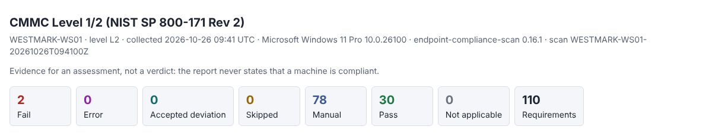
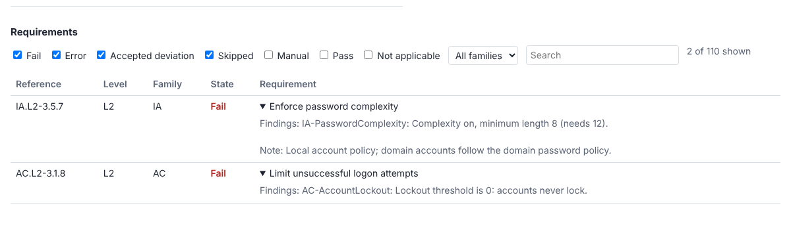
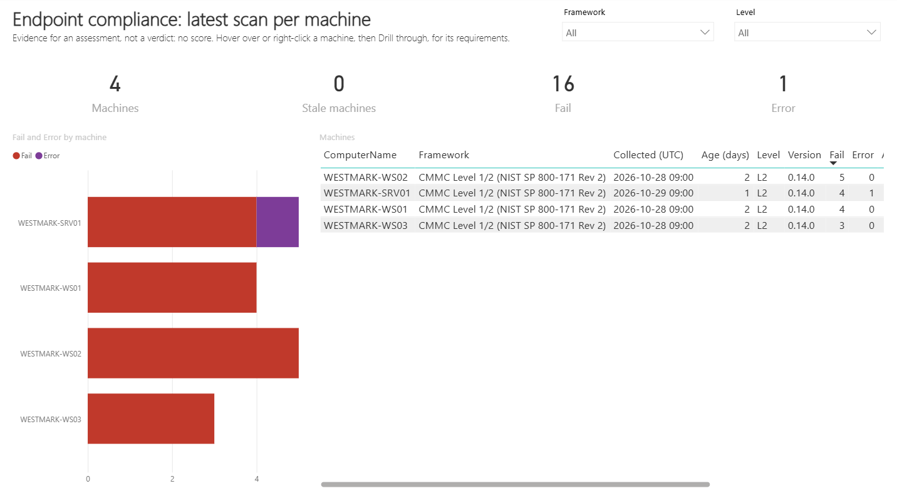
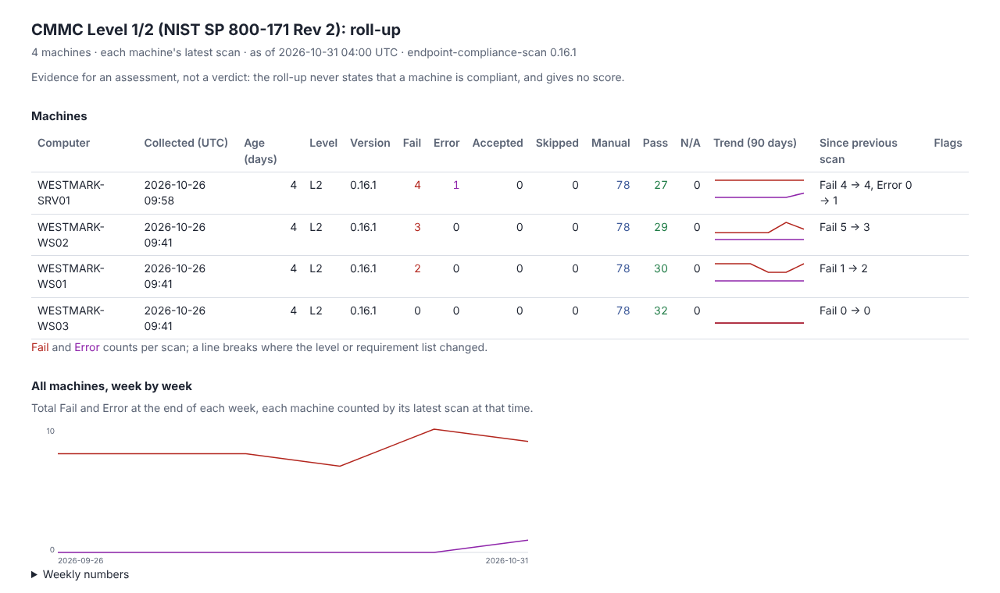

# endpoint-compliance-scan

A read-only PowerShell scanner that checks a Windows workstation or server
against one or more compliance frameworks, chosen at run time, and reports a
result with evidence for each requirement. It can run once at the console or on a
schedule across many machines, writing to a shared folder.

| Framework | `-Framework` | Levels | Requirements | With endpoint evidence |
| --- | --- | --- | --- | --- |
| CMMC Level 1/2 ([NIST SP 800-171 Rev 2](https://csrc.nist.gov/pubs/sp/800/171/r2/upd1/final)) | `CMMC` | L1, L2 | 110 | 32 |
| [NIST SP 800-171 Rev 3](https://csrc.nist.gov/pubs/sp/800/171/r3/final) | `NIST-800-171r3` | Rev3 | 97 | 24 |
| [NIST SP 800-53 Rev 5](https://csrc.nist.gov/pubs/sp/800/53/r5/upd1/final), Low and Moderate baselines | `NIST-800-53r5` | Low, Moderate | 287 | 32 |
| [DISA Windows 11 STIG](https://public.cyber.mil/stigs/) V2R11 | `DISA-STIG-Win11` | CAT I, CAT II, CAT III | 276 | 220 |
| DISA Windows Server 2019 STIG V3R8 (sunset by DISA), member server | `DISA-STIG-WS2019-MS` | CAT I, CAT II, CAT III | 247 | 188 |
| DISA Windows Server 2019 STIG V3R8 (sunset by DISA), domain controller | `DISA-STIG-WS2019-DC` | CAT I, CAT II, CAT III | 277 | 195 |
| DISA Windows Server 2022 STIG V2R11, member server | `DISA-STIG-WS2022-MS` | CAT I, CAT II, CAT III | 242 | 187 |
| DISA Windows Server 2022 STIG V2R11, domain controller | `DISA-STIG-WS2022-DC` | CAT I, CAT II, CAT III | 271 | 193 |
| DISA Windows Server 2025 STIG V1R4, member server | `DISA-STIG-WS2025-MS` | CAT I, CAT II, CAT III | 258 | 181 |
| DISA Windows Server 2025 STIG V1R4, domain controller | `DISA-STIG-WS2025-DC` | CAT I, CAT II, CAT III | 288 | 190 |
| DISA Windows Defender Firewall STIG V2R2, any Windows | `DISA-STIG-Firewall` | CAT I, CAT II, CAT III | 21 | 20 |
| DISA Active Directory Domain STIG V3R8, on a domain controller | `DISA-STIG-AD-Domain` | CAT I, CAT II, CAT III | 36 | 16 |
| DISA Active Directory Forest STIG V3R2, on a domain controller | `DISA-STIG-AD-Forest` | CAT I, CAT II, CAT III | 7 | 4 |
| DISA Windows PAW STIG V3R3, Windows 11 privileged access workstation | `DISA-STIG-PAW` | CAT I, CAT II, CAT III | 24 | 9 |
| [CIS Controls v8.1](https://www.cisecurity.org/controls/v8-1), endpoint safeguards | `CIS-v8.1` | IG1, IG2 | 18 (partial) | 18 |
| [NIST Cybersecurity Framework 2.0](https://www.nist.gov/cyberframework) | `NIST-CSF-2.0` | CSF | 106 | 11 |
| [PCI DSS v4.0.1](https://www.pcisecuritystandards.org/document_library/), endpoint requirements | `PCI-DSS-4.0.1` | PCI | 22 (partial) | 22 |
| [HIPAA Security Rule](https://www.hhs.gov/hipaa/for-professionals/security/) | `HIPAA` | HIPAA | 65 | 14 |

It is evidence for an assessment, not a verdict. Most requirements in most
frameworks are procedural, or need evidence from outside the endpoint (identity
provider, network, facility, records). The report marks those Manual and says
what an assessor would look at instead. It never states that a machine is
compliant and never computes a score.

The CIS and PCI DSS catalogs are partial: they list only the requirements an
endpoint can show evidence for, with titles written for this project. The
standards themselves have the authoritative text, and every report from a
partial catalog says it is a subset. DISA has sunset the Server 2019 STIG, so
its catalogs stay at V3R8, its final release, and those scans say so. [frameworks/README.md](frameworks/README.md)
has the sources and the catalog format.

Runs on Windows PowerShell 5.1 and PowerShell 7. Nothing else to install.

## Getting started

Install it from the PowerShell Gallery, or download it from GitHub. Either way,
scan from an elevated PowerShell (**Run as administrator**): without elevation
the checks that need it are Skipped.

**From the PowerShell Gallery**, as the `EndpointComplianceScan` module:

```powershell
Install-Module EndpointComplianceScan -Scope CurrentUser
Invoke-EndpointComplianceScan -Framework CMMC
```

The module's commands, `Invoke-EndpointComplianceScan`, `New-ComplianceRollup`
and `Register-ComplianceScanTask`, run the same scripts with the same parameters
and help. This README shows the script form, `.\Invoke-EndpointComplianceScan.ps1`;
with the module, drop the `.\` and `.ps1`. Each command sets `$LASTEXITCODE` to
the script's [exit code](#usage). `Update-Module EndpointComplianceScan` installs
a new release, in a new folder, so keep your
[local profile](#thresholds) in `%ProgramData%\EndpointComplianceScan` or pass
`-ProfilePath`, not beside the module.

**From GitHub**: download the latest
[Release](https://github.com/riffmillar-itadmin/endpoint-compliance-scan/releases/latest)
(**Source code (zip)**) and extract it, or `git clone` the repository. A
downloaded zip carries the Mark of the Web, and Windows won't run its unsigned
scripts under the `RemoteSigned` policy that Windows Server uses by default, so
unblock the extracted files first:

```powershell
cd C:\Tools\endpoint-compliance-scan        # wherever you extracted it
Get-ChildItem -Recurse -File | Unblock-File
.\Invoke-EndpointComplianceScan.ps1 -Framework CMMC
```

If PowerShell says running scripts is disabled (the Windows 11 default for
Windows PowerShell 5.1), allow them for this window only with
`Set-ExecutionPolicy -Scope Process RemoteSigned`, or follow your
organization's policy.

Reports go to `.\Reports` in the current folder; [Reports](#reports) describes
them. To scan on a schedule across many machines, see
[Scheduled scans](#scheduled-scans).

## Choosing a STIG

DISA writes a separate STIG for each Windows release, and for Windows Server a
separate one for domain controllers. Pick the one that matches the machine:

| Machine | `-Framework` |
| --- | --- |
| Windows 11 | `DISA-STIG-Win11` |
| Windows Server 2019, 2022 or 2025, member or standalone server | `DISA-STIG-WS2019-MS`, `DISA-STIG-WS2022-MS`, `DISA-STIG-WS2025-MS` |
| Windows Server 2019, 2022 or 2025, domain controller | `DISA-STIG-WS2019-DC`, `DISA-STIG-WS2022-DC`, `DISA-STIG-WS2025-DC` |
| Any of these, for its firewall (in addition to the release's STIG) | `DISA-STIG-Firewall` |
| A domain controller, for its domain and forest (in addition to the release's STIG) | `DISA-STIG-AD-Domain`, `DISA-STIG-AD-Forest` |
| A Windows 11 privileged access workstation (PAW), in addition to `DISA-STIG-Win11` | `DISA-STIG-PAW` |

`winver` or `(Get-CimInstance Win32_OperatingSystem).Caption` shows the release.
Each operating system STIG catalog names the edition and build it was written
for. Scan with another and the scan still runs, but it warns, and the report
carries the warning in `PlatformWarning`.

A STIG rule is in one of three categories. CAT I rules are the most severe: a
finding there can lead directly to a compromise. CAT II and CAT III are medium
and low. `-Level 'CAT I'` runs only the CAT I rules, and with no `-Level` the scan
covers all three.

Between a fifth and a third of each STIG can't be read from the machine: a rule
about documented procedures, an account review, or a setting the STIG leaves to
the organization. Those are Manual, and STIG Viewer has the full check text.
On a domain controller the local-account checks are NotApplicable, since a
domain controller has none; its accounts are reviewed in Active Directory.

The Active Directory STIGs are read from the directory, so scan a domain
controller of the domain (and, for the forest STIG, one in the forest root
domain). The scan reads group membership, delegation, trusts, sites, LAPS
coverage, certificate templates and the DSRM password change event through ADSI,
and falls back to the ActiveDirectory module when ADSI fails. It reads only from
the domain controller it runs on, and changes nothing. On
any other machine those rules are NotApplicable. A rule that names a person's
judgement, such as whether each administrator account is documented, is Manual
with the accounts it found listed in the evidence.

The PAW STIG is mostly about how a site runs its PAWs: training, administrative
tiers, and which systems are managed from which PAW. Those 15 rules are Manual.
The scan checks Device Guard code integrity enforcement, the local privileged
groups, who may log on locally, smart card logon and restricted remote
administration, and lists the local Administrators and the Windows version for
review.

## What it changes

Nothing. It reads the registry, security policy, user rights, audit policy,
services, Windows features, firewall, Defender, BitLocker, Device Guard, local
accounts and groups, and installed updates, and on a domain controller Active Directory, which it reads
from that domain controller itself (localhost). It makes no other network calls,
apart from writing its reports to a share when `-OutputPath` names one.
Its only side effects are
temporary files (the `secedit` and `auditpol` exports), deleted as soon as they
are read, and the report files (plus the waiting reports and run log, when
`-FallbackPath` and `-LogPath` are given).

Scheduling it does change the machine: `Register-ComplianceScanTask.ps1` copies
the scanner to Program Files and registers a scheduled task. See
[Scheduled scans](#scheduled-scans).

## Usage

```powershell
# Run without -Framework to list the frameworks and their levels.
.\Invoke-EndpointComplianceScan.ps1

# Full CMMC Level 2 scan. Run elevated, or the checks that need elevation are Skipped.
.\Invoke-EndpointComplianceScan.ps1 -Framework CMMC

# CMMC Level 1 only (the 17 FAR 52.204-21 requirements); 1 and L1 both work
.\Invoke-EndpointComplianceScan.ps1 -Framework CMMC -Level 1

# STIG CAT I rules only, and keep the raw snapshot
.\Invoke-EndpointComplianceScan.ps1 -Framework DISA-STIG-Win11 -Level 'CAT I' -SnapshotPath .\pc01.snapshot.json

# Windows Server 2022 member server STIG, with STIG Viewer checklists, into a shared folder
.\Invoke-EndpointComplianceScan.ps1 -Framework DISA-STIG-WS2022-MS -StigPath .\U_MS_Windows_Server_2022_V2R11_STIG.zip -OutputPath \\fileserver\scans

# Evaluate a saved snapshot against another framework, on any OS
pwsh -File ./Invoke-EndpointComplianceScan.ps1 -Framework NIST-800-53r5 -Level Low -FromSnapshot ./pc01.snapshot.json

# One collection, evaluated against CMMC and the Windows 11 STIG
.\Invoke-EndpointComplianceScan.ps1 -Framework CMMC, DISA-STIG-Win11
```

`-Framework` takes a framework's Id or its catalog file name, ignoring case
(`disa-stig-win11` works). A level includes the levels before it: `-Level
Moderate` covers Low and Moderate, and `-Level 'CAT II'` covers CAT I and CAT II.
Without `-Level` the scan uses the framework's highest level.

Several frameworks, as a list or one comma-separated string, are collected once
and evaluated against each in turn, and each gets its own reports. `-Level` then
applies to every one of them, so give it only when they share the level.
`-StigPath` applies to the STIG among them.

One snapshot holds the facts for every framework, so a machine scanned once can
be evaluated against any of them with `-FromSnapshot`.

Reports go to `.\Reports` in the current folder, or to `-OutputPath`; see
[Reports](#reports).

A live scan says at launch that it usually takes 2 to 5 minutes (longer on a
domain controller with a large directory) and changes nothing, and warns when the
session isn't elevated. At the console, a
progress bar names each collector as it runs, such as `Windows features (6 of
15)`, and the scan reports how long collection took. A scheduled task or CI log
gets no progress bar.

| Exit code | Meaning |
| --- | --- |
| 0 | No Fail and no Error (accepted deviations don't count as Fail) |
| 1 | At least one Fail |
| 2 | At least one Error, or the scan couldn't start (including no `-Framework`) |

With several frameworks, the exit code is the worst of them.

## Scheduled scans

`Register-ComplianceScanTask.ps1` sets up a machine to scan itself on a schedule
and write its reports to a shared folder, where the [roll-up](#roll-up-across-machines)
and the [Power BI template](#power-bi) read them. Run it elevated, from a copy of
the repository or the module, on each machine (or push the same command through
Intune, Group Policy or your management tool).

```powershell
# Weekly CMMC scan, Mondays from 02:00 with up to two hours' random delay
.\Register-ComplianceScanTask.ps1 -Framework CMMC -OutputPath \\fileserver\scans

# Daily scan of a Server 2022 member server against two frameworks, with STIG Viewer checklists
.\Register-ComplianceScanTask.ps1 -Framework CMMC, DISA-STIG-WS2022-MS -StigPath .\U_MS_Windows_Server_2022_V2R11_STIG.zip -OutputPath \\fileserver\scans -Schedule Daily -At 22:00

# Show what would change, without changing anything
.\Register-ComplianceScanTask.ps1 -Framework CMMC -OutputPath \\fileserver\scans -WhatIf

# Scan now, then remove the task and the installed copy
Start-ScheduledTask -TaskName 'Endpoint compliance scan'
.\Register-ComplianceScanTask.ps1 -Unregister -RemoveFiles
```

It checks the frameworks and level first, so a typo fails now rather than at 02:00
on Monday. Then it:

- copies the scanner, the `frameworks` folder, the example profile, your
  `ComplianceScan.local.psd1` (or `-ProfilePath`) and the `-StigPath` file to
  `%ProgramFiles%\EndpointComplianceScan`, so the task never runs code from a
  user's folder or a share;
- registers one task, `\Endpoint compliance scan`, that runs the installed copy
  with Windows PowerShell 5.1 as SYSTEM with highest privileges, so every
  collector can read what it needs. It starts late if the machine was off at
  the scheduled time, runs on battery, never runs twice at once, and is stopped
  after two hours.

Running it again replaces the task and refreshes the installed copy, so it is
also how to update a machine to a new release. A profile or STIG file that an
earlier run installed and this one doesn't give is removed, so thresholds and
accepted deviations you've dropped stop applying.

The data folder, `%ProgramData%\EndpointComplianceScan`, is made readable and
writable by SYSTEM and Administrators only. ProgramData lets any user create
files in a subfolder, and a file planted in the fallback folder would otherwise
reach the share as this computer's report. If the data folder holds a junction or
link, or anything another account owns, the script stops before installing and
says what to remove.

The task runs as SYSTEM, which has no user settings of its own, so the few STIG
rules that read a per-user (HKCU) setting are Skipped in a scheduled scan, with a
note saying to check them in a user's session.

| Parameter | Default | |
| --- | --- | --- |
| `-Framework` | (required) | One or more frameworks, collected once per run. |
| `-Level` | each framework's highest | As for the scanner. |
| `-OutputPath` | (required) | The shared folder, as a UNC path. SYSTEM can't see a user's mapped drives. |
| `-StigPath` | | The DISA STIG zip, for STIG Viewer checklists. |
| `-ProfilePath` | `ComplianceScan.local.psd1` beside the script, if any | Installed as the scanner's local profile. With neither, the scanner uses the profile in `%ProgramData%\EndpointComplianceScan`, if there is one. |
| `-Schedule` | `Weekly` | `Weekly` or `Daily`. |
| `-At` | `02:00` | Start time, local, as `HH:mm`. |
| `-DaysOfWeek` | `Monday` | Days for a weekly task. |
| `-RandomDelayMinutes` | `120` | Up to this many minutes added at random to each start, so a fleet doesn't reach the share at once. `0` turns it off. |
| `-KeepDays` | `90` | Days a report may wait in the fallback folder. |
| `-InstallPath` | `%ProgramFiles%\EndpointComplianceScan` | Where the scanner is installed. |
| `-DataPath` | `%ProgramData%\EndpointComplianceScan` | Where the fallback folder and run log live. |
| `-TaskName` | `Endpoint compliance scan` | The task's name. |
| `-Unregister`, `-RemoveFiles` | | Remove the task, and with `-RemoveFiles` the installed copy. The fallback folder and run log stay, since they may hold reports not yet delivered. |

| Exit code | Meaning |
| --- | --- |
| 0 | Done: the task is registered or removed (with `-WhatIf`, what would change is shown) |
| 2 | Nothing was scheduled or removed, or it stopped partway; the error says why |

### When the share is away

A laptop off the network or a file server that's down shouldn't lose a scan.
The task passes the scanner `-FallbackPath %ProgramData%\EndpointComplianceScan\Pending`.
When `-OutputPath` can't be written, the scan still runs, its reports go to the
fallback folder, and it warns. The next run that can write to the share first
moves the waiting reports there, oldest first, so the roll-up sees every scan in
order. Reports that wait longer than `-KeepDays` are removed, with a warning.
A waiting file the scan didn't write, because it is a link or another account
owns it, stays where it is, isn't delivered, and is named in a warning. A
fallback folder that is itself a junction or link stops the scan.

The same parameters work at the console. Without `-FallbackPath`, a report folder
that can't be written stops the scan before it collects anything.

### Run log

Each scheduled run adds a row to `%ProgramData%\EndpointComplianceScan\scan-log.csv`
(the scanner's `-LogPath`), so a machine whose reports stop arriving can be
checked locally:

| Column | |
| --- | --- |
| `TimeUtc` | When the run ended. |
| `Computer`, `Frameworks` | What was scanned. |
| `ExitCode` | As above: 0, 1 or 2. |
| `Destination` | The folder the reports went to: the share, or the fallback folder. |
| `Delivered`, `Pending`, `Removed` | Waiting report files moved to the share, still waiting, and removed after `-KeepDays`. |
| `Message` | The error, when the run couldn't finish. |

Rows older than a year are dropped. The task's own history in Task Scheduler
shows the exit code too, as Last Run Result.

### Share permissions

The task writes as the computer account (`WESTMARK\PC01$`), so the machines need
a domain and a share they can write to. Reports name computers and local
accounts, so it helps if each machine can add its own reports and not read
anyone else's. One way, on the file server, run elevated (replace the domain and
group names with your own):

```powershell
New-Item -ItemType Directory -Path D:\Scans
New-SmbShare -Name scans -Path D:\Scans -ChangeAccess 'WESTMARK\Domain Computers' -ReadAccess 'WESTMARK\Compliance Readers' -FullAccess 'BUILTIN\Administrators'

# Machines may create files in the folder but not list it. Each machine's own
# files are its to replace or delete (CREATOR OWNER). Readers read everything.
icacls D:\Scans /inheritance:r /grant:r 'BUILTIN\Administrators:(OI)(CI)F' 'NT AUTHORITY\SYSTEM:(OI)(CI)F' 'WESTMARK\Compliance Readers:(OI)(CI)RX' 'WESTMARK\Domain Computers:(X,RA,REA,RC,WD)' 'CREATOR OWNER:(OI)(IO)M'
```

Try it with one machine before the fleet: register the task, run
`Start-ScheduledTask`, and check that its reports arrive and its run log says
the share. With these permissions a reader can't write to the share, so give
the roll-up an `-OutputPath` elsewhere.


## Reports

Each run writes these files, named `compliance-scan-<scan id>-<framework>`. The
scan ID is the computer and the UTC time the snapshot was collected, for example
`PC01-20261020T150000Z`. In a folder of many machines' reports the names sort by
computer, then time, and evaluating the same snapshot again replaces its reports.

| File | For |
| --- | --- |
| `.html` | People. One self-contained page that opens offline, can be emailed, and prints to PDF. It has summary counts and a table by family, and lists requirements that can be filtered by state, family and text, each expanding to its evidence. |
| `.records.json` | Power BI and other tools. A flat array with one record per requirement, each repeating the scan ID, computer, collection time, OS, framework and level. |
| `.csv` | Spreadsheets. One row per requirement. |
| `.json` | The full record: requirements, every check's evidence, and the thresholds used. |
| `.cklb` | STIG Viewer 3. Written for a STIG framework when `-StigPath` names the STIG. |
| `.ckl` | STIG Viewer 2, and tools that read the older format. Written with the `.cklb`. |

The reports name the computer and its local accounts, so treat them as internal
records.

The HTML report opens with the counts, then a table by family, then the
requirements. It starts on the ones that need attention, each opened here to
its findings:





These screenshots, and the Power BI and roll-up ones below, come from the
fictional WESTMARK test machines, with a few settings changed so that some requirements fail.

### Power BI

Point every machine's `-OutputPath` at one shared folder. The Power BI template
reads every `.records.json` in it, subfolders included, and needs nothing else:
not the roll-up, and no account. [Power BI Desktop](https://powerbi.microsoft.com/desktop/)
is free and works without signing in.

Download `EndpointComplianceScan.pbit` from the [latest release](../../releases/latest)
and open it. Power BI asks for three parameters. The boxes start empty, so
fill in all three:

| Parameter | Suggested value | What it does |
| --- | --- | --- |
| `ReportFolder` | your share, such as `\\fileserver\scans` | The folder that holds the scan reports. |
| `StaleDays` | 30 | A latest scan older than this is flagged Stale. |
| `TrendDays` | 90 | Days of scans the Trends page shows. |

The template ships without parameter values, so it can't fill these in. To
change them later, choose Transform data, then Edit parameters.

The template has four pages. When the folder holds several frameworks, pick
one in the Framework slicer on the first three.

- **Overview.** Each machine's latest scan: machines, stale machines, and Fail
  and Error totals, states by machine, and a table of every machine with its
  state counts, age, level, version and flags (Stale, Not elevated, Platform
  warning).
- **Trends.** Fail and Error for each scan in the trend window, a line per
  machine, and a week-by-week line for all machines that counts each machine by
  its latest scan at the end of the week. A machine's line breaks where its
  level or requirement list changed, because the counts don't compare across
  that, and the Scans table marks each scan's comparability.
- **Requirements.** The latest scans as a grid of requirements by machine (F
  Fail, E Error, A Accepted, S Skipped, M Manual, P Pass, - N/A), with the most
  failing requirements beside it. Family and State slicers narrow it.
- **Machine detail.** Hover over or right-click a machine on another page and
  choose Drill through. It lists the machine's requirements with findings, evidence and
  notes.



Like the scan's own reports, the template shows counts and states, never a
score. Refresh after new scans arrive. The template keeps no data, but a
`.pbix` saved from it does, so treat that file like the reports.

The template's source is the Power BI project in [powerbi/](powerbi/), plain text
that Power BI Desktop opens directly (`EndpointComplianceScan.pbip`). To use the
records in a report of your own instead, choose Get data, then Folder, pick the
folder, and filter the file list to names ending in `.records.json`. Combine the
files: each record becomes a row. Group by `ScanId` and `Framework` for one
scan, or by `ComputerName` and `CollectedUtc` for trends.

### Roll-up across machines

When many machines write their reports to one shared folder,
`New-ComplianceRollup.ps1` combines them into one page per framework. It reads
the `.json` reports and doesn't scan or re-evaluate anything.

```powershell
.\New-ComplianceRollup.ps1 -Path \\fileserver\scans
.\New-ComplianceRollup.ps1 -Path .\Reports -Framework DISA-STIG-WS2025-MS -MaxAge 7 -OutputPath .\Rollup
```



Each computer counts once per framework, by its latest scan in the folder. For
each framework it writes `compliance-rollup-<framework>.html`, `.csv` and
`-trend.csv` to `-OutputPath`, or to the folder it read from:

- **Machines.** Each machine's Fail, Error, Accepted, Skipped, Manual, Pass and
  N/A counts, its scan date, level and tool version. A scan older than `-MaxAge`
  days (default 30), one run without elevation, and one with a platform warning
  are flagged. A small trend line shows its Fail and Error counts across its
  scans of the last `-TrendDays` days (default 90), next to the change since its
  previous scan.
- **All machines, week by week.** Total Fail and Error at the end of each week,
  each machine counted by its latest scan at that time, with the numbers in a
  table below the chart.
- **Changes since the previous scan.** For each machine, the requirements that
  now Fail or Error and the ones that no longer do.
- **Requirements by machine.** Each requirement's state on each machine, with
  the requirements failing on the most machines first. It can be filtered to
  requirements with a Fail or Error, by family and by text, and each cell shows
  its findings when you hover over it. The `.csv` holds the same grid, with a
  column per machine.
- **Trend CSV.** `-trend.csv` has one row per scan in the trend window:
  `Computer`, `CollectedUtc`, `Level`, `Version`, `IsElevated`, `Requirements`,
  a count per state, and `ComparableWithPrevious` (blank for a machine's first
  scan, then `Yes` or `No`). It suits Power BI and other tools.

Counts compare only between scans at the same level that list the same
requirements. Where that changes, the machine's trend line breaks, the page
names the machine, and the change is marked "not comparable".

Machines scanned at another level, or with an older catalog, can list different
requirements. The page says so, and a cell is blank where a machine's scan
doesn't include the requirement. Like the scan's own reports, the roll-up shows
counts and states, never a score. `-Recurse` also reads subfolders. Exit code 0
means the roll-ups were written, and 2 means the folder holds no scan reports
or they couldn't be written.

### STIG Viewer checklists

The catalogs hold short titles, not DISA's rule text, so the checklists need the
STIG itself. Download the STIG zip from [cyber.mil](https://public.cyber.mil/stigs/downloads/)
and pass it, or the XCCDF file inside it, with `-StigPath`:

```powershell
.\Invoke-EndpointComplianceScan.ps1 -Framework DISA-STIG-WS2022-MS -StigPath .\U_MS_Windows_Server_2022_V2R11_STIG.zip
```

Open the `.cklb` in STIG Viewer 3, which doesn't open `.ckl` files. The `.ckl`
holds the same results for STIG Viewer 2. Both list every rule of the STIG, along
with its text:

| Scan result | Checklist status |
| --- | --- |
| Pass | Not a Finding |
| Fail | Open |
| Accepted | Open, with the deviation's reason in Comments |
| NotApplicable | Not Applicable |
| Manual, Skipped, Error | Not Reviewed |
| Not in the catalog, or above `-Level` | Not Reviewed, with a comment saying why |

Finding Details holds the evidence, and Comments holds the scan ID and any
note. Where the catalog splits a rule in parts (`V-254343.a`, `.b`), the
checklists take the worst part. If the file shares fewer than 80% of the
catalog's Vuln IDs, it is another STIG or release, and the scan stops before
collecting anything. Without `-StigPath`, a STIG scan says how to get the
checklists and writes the other reports.

## Results

| State | Meaning |
| --- | --- |
| Pass | Evidence collected and it meets the threshold |
| Fail | Evidence collected and it misses the threshold |
| Error | A collector or check threw; the message is in the report |
| Accepted | A Fail that an [accepted deviation](#accepted-deviations) covers; the evidence and the reason stay in the report |
| Skipped | The check applies but couldn't run (usually: not elevated) |
| Manual | The endpoint can't show this; the note says what can |
| NotApplicable | The thing checked is absent, for example RDP idle limits with RDP off, or local accounts on a domain controller |

A requirement takes the worst state among its evidence. Nothing passes by
default: a fact missing from the snapshot is an Error, and a requirement whose
checks were Skipped is Skipped, not Pass. Where Windows has a documented default
for an unset value (for example `EnableLUA`), a check uses it and says so in the
evidence.

The CSV has one row per requirement: `Requirement` (the catalog Id),
`Reference` (the ID to quote, such as the CMMC practice `AC.L2-3.1.8`), `Level`,
`Family`, `Title`, `State`, `Checks` (each piece of evidence and its state),
`Evidence`, `Findings` (only the evidence that didn't pass) and `Note`.

## Evidence

A requirement gets its evidence from two places.

**Named checks** in the script, which apply judgement: 33 of them.

| Family | Checks |
| --- | --- |
| AC | Guest disabled; no enabled account without a password requirement; UAC on, prompting on the secure desktop, and never elevating without a prompt; local Administrators count; account lockout; logon banner; machine inactivity lock; RDP off or NLA required; RDP idle timeout |
| AU | Advanced audit subcategories (matched by GUID, so any display language works); Sensitive Privilege Use; Security log size; time sync |
| CM | SMBv1 off; listed nonessential services absent or disabled; AlwaysInstallElevated off; Autorun and AutoPlay off |
| IA | Password complexity and length; password history; no LM hashes or reversible encryption; NTLMv2 only; blank passwords limited to console logon |
| MP | Removable storage policy |
| SC | Host firewall on with inbound Block on every profile; TLS 1.0 and 1.1 off; FIPS mode; BitLocker on the OS volume |
| SI | Recent Windows update; real-time antivirus (Defender, or another product registered with Security Center); signature age; recent scan |

**Setting expectations** in the catalog, for rules that are a single setting:
a registry value, a security policy value, an audit subcategory, a user right, a
service's start type, a Windows feature, a named endpoint test, or on a domain
controller a named directory test. Most of the STIGs' automated rules are these.

A per-user (HKCU) setting is read from the account running the scan. A scan run
as SYSTEM, as a scheduled scan is, reports those rules Skipped rather than judging
SYSTEM's own settings.

User rights are matched by SID, so the result is the same in any Windows display
language. Domain Admins and Enterprise Admins are required only on a machine in
a domain.

The password checks read the local account policy. On a domain-joined machine,
domain accounts follow the domain password policy, which is assessed on the
domain controllers.

## Thresholds

Most frameworks leave values to the organization. Thresholds apply in this
order, later winning:

1. [`ComplianceScan.example.psd1`](ComplianceScan.example.psd1), the defaults
2. the framework's own `Thresholds` in its catalog, for example the STIG's
   14-character passwords and lockout after 3 attempts, or PCI DSS's 30-minute
   lockout
3. your local profile: the file `-ProfilePath` names, else
   `ComplianceScan.local.psd1` beside the script, else
   `%ProgramData%\EndpointComplianceScan\ComplianceScan.local.psd1`

To change a value, create `ComplianceScan.local.psd1` with only the keys you
change; it is gitignored. If your value is looser than one the framework sets,
the scan warns and uses yours. The scan names the profile it uses.

The `%ProgramData%` location suits the Gallery module, which each update
installs in a new folder. Create it from an elevated PowerShell. Any user can create a folder
in ProgramData, and a planted profile could accept Fails as deviations, so the
scan stops if that file or its folder is a junction or link, or is owned by an
account other than SYSTEM, Administrators, TrustedInstaller or the one running
the scan. A scheduled scan's data folder is that same folder, already limited to
SYSTEM and Administrators.

`RequireFipsMode` and `RequireRemovableMediaPolicy` can be set to `$false` when
FIPS-validated modules or device control are evidenced some other way. Those
checks then report Manual instead of Fail.

## Accepted deviations

Some Fails are known and accepted, such as a right Windows grants by default
that a STIG doesn't allow. List them under `Deviations` in
`ComplianceScan.local.psd1`, each with the rule and the reason:

```powershell
@{
    Deviations = @(
        @{
            Rule      = 'V-278252'
            Framework = 'DISA-STIG-WS2025-DC'
            Identity  = 'RESTRICTED SERVICES\PrintSpoolerService'
            Reason    = 'Windows Server 2025 grants this to the print spooler by default; accepted by the ISSM.'
            Expires   = '2027-06-30'
        }
    )
}
```

| Key | Meaning |
| --- | --- |
| `Rule` | The requirement ID (required). `V-1` also covers a split rule's parts, `V-1.a` and `V-1.b`. |
| `Reason` | Why it is accepted, and by whom (required) |
| `Framework` | Limits it to one framework's Id. Without it, the rule ID is matched in whichever framework is scanned. |
| `Identity` | For a user right, the exact accounts accepted, by full name (`DOMAIN\name`) or SID. Anyone else holding the right still fails, and a look-alike name doesn't match. |
| `Expires` | The last day it applies (`yyyy-MM-dd`), judged against the scan's collection date. After that the rule fails again and its note says the deviation expired. |

A Fail that a deviation covers reports as **Accepted**. The requirement keeps
its findings and evidence, its note carries the reason, and STIG Viewer
checklists keep it Open with the reason in Comments. Accepted doesn't count
toward exit code 1. A deviation never accepts an Error, Skipped or Manual
result. If it doesn't cover every Fail in the rule, for example because another
account also holds the right, the rule stays Fail and its note says what the
deviation doesn't cover. When a listed rule no longer fails, its note says the
deviation may no longer be needed. A malformed entry stops the scan.

## Compatibility

From 1.0.0 the project follows [semantic versioning](https://semver.org). Within
1.x these stay compatible:

- the scripts' and the module commands' parameters, and what they mean;
- the exit codes;
- report file names, the CSV columns, the JSON and `.records.json` fields (which
  the Power BI template and the roll-up read), and the STIG Viewer checklist
  formats. New columns and fields may be added;
- the snapshot: a 1.x release reads every snapshot an earlier 1.x wrote;
- the catalog format in `frameworks/`, and the local profile's keys.

A minor release adds frameworks, checks or fields, or updates a catalog to a new
release of its standard, such as a new DISA STIG. Results can change in a minor
or patch release, since a catalog update or a fixed check can turn a Pass into a
Fail. A patch release fixes bugs. Anything that breaks the list above waits for
2.0.

Supported: Windows PowerShell 5.1 and PowerShell 7 on Windows 11 and Windows
Server 2019 or later. `-FromSnapshot` and the roll-up also run under
PowerShell 7 on Linux and macOS.

## Testing

```powershell
.\Test-ComplianceScan.ps1 -BothEditions    # Pester suite under 5.1 and 7
.\Test-ComplianceScanLint.ps1              # PSScriptAnalyzer; run under pwsh and powershell.exe
```

The suite feeds fixture snapshots to the checks, so it needs no network, no
elevation and no Windows. It builds the Gallery module with
`tools/Build-Module.ps1`, imports it, and scans a fixture through its commands,
and the lint script lints the built module as well as the repository. It also checks the Power BI project: every field
the report uses is in the model, and the model reads the fields the scanner
writes. For every framework it checks the catalog's shape and
that a snapshot meeting every expectation passes. Skipped tests fail the run.
The Tests workflow runs the suite, lint on both editions, and a live scan of the
runner on both editions, evaluated against every framework. It also registers the
scheduled task on the runner and checks it, and on Windows PowerShell 5.1 runs the
task twice: once to a writable folder, and once to one that can't be written,
whose reports must wait in the fallback folder. Then it removes the task.

Both scripts are pinned to one version of their tool (Pester 6.2.0,
PSScriptAnalyzer 1.25.0) and install it for the current user if it's missing.
They try the PowerShell Gallery first. If that fails, they download the same
version from a second site (nuget.org for Pester, the GitHub release for
PSScriptAnalyzer) and check it against a SHA-256 pinned in
`tools/Install-PinnedModule.ps1`. On a machine with no internet access, save
`Pester.6.2.0.nupkg` or `PSScriptAnalyzer.1.25.0.nupkg` from the Gallery to a
folder and pass that folder with `-PackagePath`. Each source that fails is
reported, along with the one that worked.

## Updating the catalogs

The NIST and DISA STIG catalogs are generated from published data by
`tools/Update-FrameworkCatalog.ps1`; the CMMC, CIS, PCI DSS and HIPAA catalogs are
written by hand.

```powershell
.\tools\Update-FrameworkCatalog.ps1                                  # rebuild from the pinned sources
.\tools\Update-FrameworkCatalog.ps1 -SourcePath .\sources -Offline   # from saved files only
.\tools\Update-FrameworkCatalog.ps1 -Framework DISA-STIG-Win11 -StigPath .\U_MS_Windows_11_V2R12_STIG.zip -WhatIf
```

Which checks answer which requirement is data in `tools/mappings/`, not code.
`tools/mappings/sources.psd1` pins every source file by SHA-256: NIST's OSCAL
content, Microsoft's PowerStig processed STIGs, and DISA's STIG zips. Each file
comes from the first place that has it with the right hash: `-SourcePath`, the
download cache, each mirror in turn, then the PowerStig package on the PowerShell
Gallery. A source that is down or hands back other content is reported and the
next one is tried.

A STIG catalog with a DISA zip follows that DISA release: its rules, severities
and version are DISA's, and the automated checks come from PowerStig by Vuln ID.
Rules new in the release are Manual until mapped, and retired rules are dropped.
Where DISA has reworded the check of an automated rule since PowerStig's release,
the generator lists the rule, so a person can confirm the expected value and
record it as an override or as reviewed in `tools/mappings/disa-stig.psd1`.
The build stops on an automated rule whose expected value a person hasn't
reviewed: a blank value, a check that lists several allowed values (PowerStig
keeps one), or a check DISA waives when another rule is met. A correction in the
mappings settles each one.
`-StigPath` tries a newer DISA release before it is pinned.

PowerStig doesn't process the Active Directory or PAW STIGs, so their catalogs are
built from DISA's zip alone. Their automation is written in the mappings, along
with the release it was checked against. A newer DISA release stops the build
until a person checks each automated rule against it.

## Changelog

| Version | Date | Changes |
| --- | --- | --- |
| 1.0.0 | 2026-11-02 | First stable release; [Compatibility](#compatibility) says what 1.x keeps stable. Also on the PowerShell Gallery as the `EndpointComplianceScan` module (`Install-Module EndpointComplianceScan`), whose commands `Invoke-EndpointComplianceScan`, `New-ComplianceRollup` and `Register-ComplianceScanTask` run the same scripts with the same parameters; `tools/Build-Module.ps1` builds it, and the tests build and import it on both editions. Reports now default to `.\Reports` in the current folder, as the README said, instead of a Reports folder beside the script. Without `-ProfilePath` or a `ComplianceScan.local.psd1` beside the script, the scanner uses `%ProgramData%\EndpointComplianceScan\ComplianceScan.local.psd1`, and stops if that file or its folder is a link or another account owns it. The scan names the local profile it uses. `New-ComplianceRollup.ps1 -MaxAge` takes 1 to 3650 days. README: Getting started (download, unblock, run elevated), Compatibility, and the task script's exit codes; SECURITY.md covers scheduled scans and supported versions; help lists every STIG and the side effects. |
| 0.17.0 | 2026-11-01 | Fixes before 1.0. `Register-ComplianceScanTask.ps1` makes the data folder readable and writable by SYSTEM and Administrators only, since ProgramData lets any user create files in a subfolder and a planted file in the fallback folder would reach the share as that computer's report; a data folder holding a link, or anything another account owns, is refused. The scanner doesn't deliver a waiting file that is a link or that another account owns, and stops when the fallback folder is a link. Registering again removes a profile or STIG file an earlier run installed, so dropped thresholds and accepted deviations stop applying. A scan run as SYSTEM reports per-user (HKCU) settings Skipped instead of judging SYSTEM's own, which made those STIG rules fail in every scheduled scan. Snapshot schema 6, which records whether the scan ran as SYSTEM; schema 5 snapshots still read. On Windows Server without the BitLocker feature, the BitLocker check now reports a Fail saying BitLocker isn't installed; before, the collector errored and the scan exited 2. `.gitignore` covers every report and roll-up file. New tests keep the README's framework table, the version notes, the changelog and the live-scan job's framework list in step with the code. |
| 0.16.1 | 2026-10-30 | README: screenshots of the HTML report, the Power BI template and the roll-up, made from the fictional WESTMARK test machines. |
| 0.16.0 | 2026-10-30 | Scheduled scans. `Register-ComplianceScanTask.ps1` installs the scanner to Program Files and registers a weekly (or daily) task that runs it as SYSTEM, with a random delay, writing to a shared folder; `-Unregister` removes it. The scanner takes several frameworks in one run, collecting once. When `-OutputPath` can't be written, `-FallbackPath` keeps the reports and a later run delivers them, oldest first; `-KeepDays` (default 90) removes ones that wait too long. `-LogPath` adds a row per run to a CSV. The README gives share permissions that let machines add reports without reading each other's. |
| 0.15.1 | 2026-10-30 | README: the Power BI template opens with its three parameters empty, so the table gives suggested values to type in, and says where to change them later. |
| 0.15.0 | 2026-10-29 | Power BI template. `EndpointComplianceScan.pbit` on the Release, built from the Power BI project in `powerbi/`, reads every `.records.json` in a folder: an Overview of each machine's latest scan, Trends per machine and week by week (lines break where scans don't compare), a Requirements grid, and a Machine detail drill-through. No account needed. |
| 0.14.0 | 2026-10-28 | Roll-up trends. The roll-up uses every scan in the folder from the last `-TrendDays` days (default 90): each machine gets a Fail and Error trend line and its change since the previous scan, a week-by-week chart totals all machines, and a table lists the requirements that newly Fail or Error, or no longer do. A new `-trend.csv` has one row per scan. Trend lines break where a level or requirement list changes, and the page says so. |
| 0.13.0 | 2026-10-28 | The HIPAA catalog is complete: every standard and implementation specification of the Security Rule (164.308 to 164.316), 65 in all, with the administrative, physical and organizational ones Manual. A catalog can be marked `Retired`; the Server 2019 STIGs are, and their scans and HTML reports say that V3R8 is DISA's final release. |
| 0.12.1 | 2026-10-27 | A relative folder such as `.\Reports`, given to the scanner's `-OutputPath` or the roll-up's `-Path` or `-OutputPath`, is now written under the current PowerShell folder. Before, it went under the folder PowerShell started in (often the home folder), or failed if that folder had no such subfolder. |
| 0.12.0 | 2026-10-27 | Roll-up across machines. `New-ComplianceRollup.ps1` reads a folder of scan reports and writes one page and one CSV per framework, using each machine's latest scan. The page lists each machine's counts, flagging stale scans (older than `-MaxAge` days), unelevated scans and platform warnings. A requirement-by-machine grid puts the requirements that fail on the most machines first. The Tests workflow rolls up the runner's reports. |
| 0.11.2 | 2026-10-27 | The test scripts no longer depend on the PowerShell Gallery alone. If it fails, Pester comes from nuget.org and PSScriptAnalyzer from its GitHub release, each checked against a pinned SHA-256. A local package can be given with `-PackagePath`. An Install-Module failure reported without an exception now counts as a failure. |
| 0.11.1 | 2026-10-27 | Console output is easier to read. The launch notice and the results header are short blocks set apart in colour, with a warning at launch when the session isn't elevated. Notes and findings wrap between words to the window width, with continuation lines indented under the text, so columns stay aligned. Report files are listed one per line under their folder. A scheduled task or redirected output gets unwrapped lines. |
| 0.11.0 | 2026-10-27 | Accepted deviations: list a rule, its reason, and optionally the framework, the exact accounts and an expiry date under `Deviations` in `ComplianceScan.local.psd1`. A Fail they cover reports as Accepted, keeping its evidence and the reason in every report; STIG Viewer checklists keep it Open with the reason in Comments, and it doesn't count toward exit code 1. A deviation never accepts an Error, and an account-specific one covers only those exact accounts. A live scan now says at launch how long it usually takes, shows a progress bar per collector at the console, and reports how long collection took. |
| 0.10.1 | 2026-10-26 | The features collector falls back to CIM (`Win32_OptionalFeature`) when DISM's `Get-WindowsOptionalFeature` fails, as it can under PowerShell 7 ("Class not registered"). Before, the collector reported an Error and every optional feature rule went with it. |
| 0.10.0 | 2026-10-26 | DISA Windows PAW STIG V3R3 as `DISA-STIG-PAW`, for Windows 11 privileged access workstations: 24 rules, 7 automated and 2 with evidence for review. New Device Guard collector (code integrity enforcement), and the local accounts collector also records the members of the local privileged groups, through CIM with an ADSI fallback. A new `Local` expectation source runs named endpoint tests for rules that read more than one setting or need judgement. Snapshot schema 5. |
| 0.9.1 | 2026-10-25 | Directory findings name a well-known SID group member, such as Everyone or Anonymous Logon, instead of showing its SID. The directory stores these members as foreign security principals named only by SID, so a lab domain controller scan reported "includes S-1-1-0". Saved snapshots show the names too, since the names are applied when the snapshot is evaluated. |
| 0.9.0 | 2026-10-25 | DISA Active Directory Domain STIG V3R8 (`DISA-STIG-AD-Domain`, 36 rules, 16 automated) and Forest STIG V3R2 (`DISA-STIG-AD-Forest`, 7 rules, 4 automated), for domain controllers. A new directory collector reads Active Directory through ADSI, falling back to the ActiveDirectory module, and is NotApplicable on any machine that isn't a domain controller. It checks administrator group separation, accounts that can be delegated, Protected Users, unconstrained delegation, trusts (SID filtering and selective authentication), Pre-Windows 2000 Compatible Access, Schema Admins, LAPS coverage, smart card hash rolling, the DSRM password age, the functional level, inter-site replication, anonymous forest access, the forest root time source and certificate templates. These use a new `Directory` expectation source. Snapshot schema 4. The catalog generator builds a STIG catalog from DISA's zip alone, with automation from the mappings pinned to the release it was checked against. |
| 0.8.1 | 2026-10-25 | STIG fixes found by scanning a lab domain controller. The SMB1 registry settings are NotApplicable when the SMB1 feature is removed, and SMB1 removal is NotApplicable when both settings are made, as DISA's checks say, on Windows 11 and Server 2019, 2022 and 2025. This uses a new `NotApplicableIf` expectation key. Diagnostic data (`AllowTelemetry`) accepts DISA's values: 0 or 1 on Windows 11 and Server 2025 (Server 2025 had expected an empty value), and 1 or 3 on Server 2022. Delivery Optimization accepts 0, 1, 2, 99 or 100 on Windows 11 and Server 2025. The Server 2025 administrator UAC prompt accepts 1 or 2. On Windows 11, Windows Analytics diagnostic data is NotApplicable when diagnostic data is Security or Basic. Its Settings-based Delivery Optimization value applies only off a domain, through a new `StandaloneOnly` key. The catalog generator applies corrections whatever release a catalog follows. It stops on a value nobody has reviewed. |
| 0.8.0 | 2026-10-24 | DISA Windows Defender Firewall STIG V2R2 as `DISA-STIG-Firewall`, for any Windows: 21 rules, 20 automated. Registry expectations take an optional `FallbackPath`: the Group Policy value is read first and the local firewall setting only when no policy value exists, as the STIG's checks say. The Domain profile and policy-merge rules are NotApplicable on a system that isn't joined to a domain. The catalog generator joins a STIG's policy and local parts into one rule (`PolicyFallback`), and reads organization-defined values whose PowerStig comment has extra spacing, which it used to miss. |
| 0.7.0 | 2026-10-24 | The Windows Server 2022 and 2025 STIG catalogs follow DISA's current releases, V2R11 and V1R4, and each rule DISA changed was reviewed. Maximum password age is 180 days, the Security log example size is DISA's 5120000 KB, and the 2025 domain controller checks LDAP server signing (`LDAPServerEnforceIntegrity`). Hardened UNC paths, Credential Guard and virtualization-based security are NotApplicable on a system that isn't joined to a domain, through a new `DomainOnly` expectation key. The 12 rules new in 2025 V1R4 (11 for OpenSSH, one for the servicing level) are Manual, and retired rules are dropped. The role split follows DISA's STIG IDs. Registry values DISA allows to be absent now pass when absent on Server 2019 and 2022, which fixes false failures. Server 2019 stays on V3R8, because DISA has sunset that STIG. |
| 0.6.0 | 2026-10-24 | Catalog generator `tools/Update-FrameworkCatalog.ps1`, in PowerShell, with the check mappings as data in `tools/mappings/`. Sources are pinned by SHA-256 and fetched with failover across mirrors and the PowerShell Gallery, or read offline with `-SourcePath`. STIG catalogs can follow a DISA release newer than PowerStig's. The Windows 11 STIG catalog now follows DISA's V2R11: 276 rules, 2 new rules Manual, 8 retired rules dropped, and the maximum password age raised from 60 to 180 days. |
| 0.5.0 | 2026-10-24 | STIG Viewer 3 checklist (`.cklb`), written beside the `.ckl` when `-StigPath` names the STIG, because STIG Viewer 3 doesn't open `.ckl` files. It follows the layout STIG Viewer 3.8.1 saves. |
| 0.4.1 | 2026-10-24 | Fix: the STIG Viewer checklist failed with "hexadecimal value 0x00, is an invalid character" when evidence held a NUL, as some registry values do. Characters XML can't hold are now dropped from the `.ckl`, and registry strings drop trailing NULs. |
| 0.4.0 | 2026-10-24 | Reports. A self-contained HTML report, flat JSON records for Power BI, and a STIG Viewer checklist (`.ckl`) when `-StigPath` names the DISA STIG zip or XCCDF file. Reports are named by scan ID (computer and collection time), so a shared folder sorts by computer, then time. |
| 0.3.0 | 2026-10-23 | Windows Server: DISA STIGs for Windows Server 2019, 2022 and 2025, each for member servers and domain controllers. User rights expectations and collector, added to every STIG catalog. Kerberos policy on domain controllers. Server roles and features. Each STIG catalog names its Windows edition and build, and the scan warns when the machine differs. Local-account checks are NotApplicable on a domain controller. Snapshot schema 3. |
| 0.2.0 | 2026-10-23 | Renamed from cmmc-endpoint-scan. Eight frameworks, one chosen per run with `-Framework` and `-Level`: CMMC, NIST SP 800-171 Rev 3, NIST SP 800-53 Rev 5 Low/Moderate, DISA Windows 11 STIG, CIS Controls v8.1, NIST CSF 2.0, PCI DSS 4.0.1, HIPAA Security Rule. Setting expectations in catalogs; optional features collector; new checks for UAC prompt behaviour, AutoPlay and blank-password logons; per-framework thresholds; snapshot schema 2. |
| 0.1.0 | 2026-10-23 | First draft: catalog of all 110 requirements, 30 endpoint checks, CSV and JSON reports, Pester suite, CI on both editions. |

## License

Apache-2.0. See [LICENSE](LICENSE). Framework content belongs to its publishers;
see [frameworks/README.md](frameworks/README.md).
